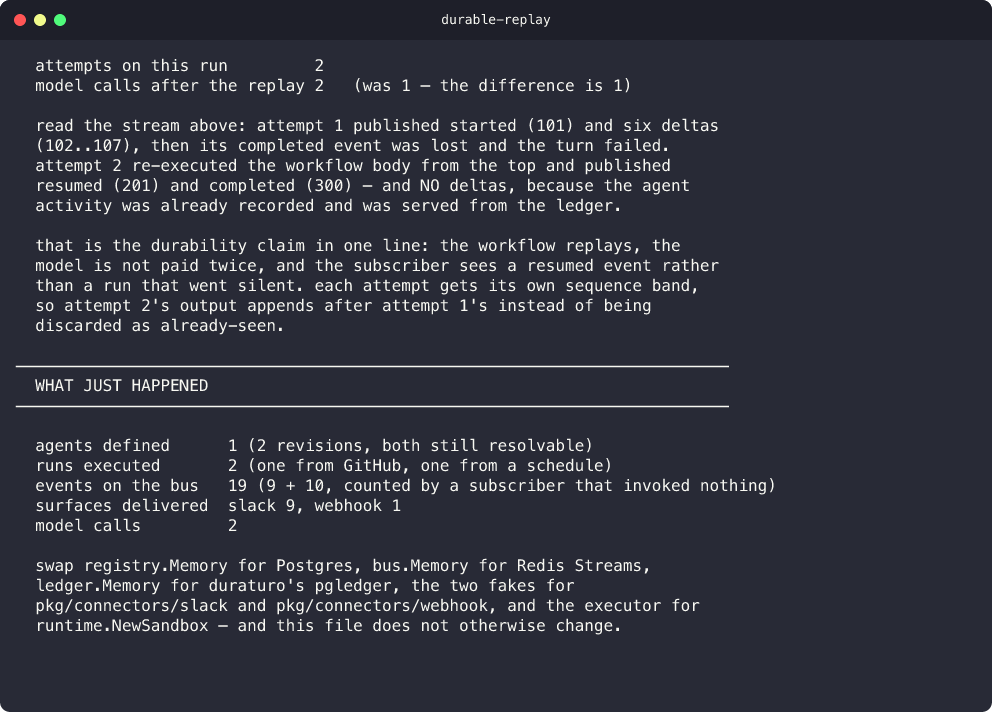

<p align="center">
  <h1 align="center">fiber</h1>
  <p align="center">
    Define agents, run them durably, and stream answers across your tools.
    <br /><br />
    <a href="https://github.com/urmzd/fiber/releases">Download</a>
    &middot;
    <a href="https://github.com/urmzd/fiber/issues">Report Bug</a>
    &middot;
    <a href="https://pkg.go.dev/github.com/urmzd/fiber">Go Docs</a>
  </p>
</p>

<p align="center">
  <a href="https://github.com/urmzd/fiber/releases"></a>
  &nbsp;
  <a href="https://github.com/urmzd/fiber/actions/workflows/ci.yml"></a>
  &nbsp;
  <a href="https://pkg.go.dev/github.com/urmzd/fiber"></a>
  &nbsp;
  <a href="LICENSE"></a>
</p>

<p align="center">
  
</p>
<p align="center"><em>Real output from the offline example. The model and destination services are simulated.</em></p>

> ## Status
>
> **fiber is v0 alpha software. It is pre-1.0 and not recommended for
> production.**
>
> Interfaces are still moving and may change between minor versions, and a minor
> release may require code changes on your side.
>
> What that means concretely today:
>
> - **Works and is tested.** The single-binary deployment (in-memory bus, ledger
>   and registry), the topic and delivery model, durable runs with replay, the
>   Connect and SSE transports, and the Slack, GitHub, Jira, cron and webhook
>   connectors.
> - **New and lightly exercised.** Postgres persistence for agent specs, runs
>   and knowledge (`FIBER_POSTGRES_URL`), the knowledge layer, the built-in
>   `author` agent, and history compaction. The Postgres backends pass the same
>   suites as their in-memory counterparts in CI's integration job and in
>   `make e2e`; none of it has seen production load.
>
> See [Limitations](#limitations) for the full list.

fiber is an agent platform and a low-latency pub/sub bus. Define an agent with
a spec, tag it from Slack, GitHub, Jira or a schedule, and its events stream to
any subscriber while being delivered to any destination you name.

**Where a tag is raised and where its answer lands are independent.** A GitHub
request can stream into Slack while a webhook receives only its completion
event. Each run pins an agent revision, so retries use the same definition.

## Features

- **Agents are documents.** Create one by submitting a spec. No redeploy, no code, no restart.
- **Subscribe once.** `agent:docs-bot` receives current and future runs of that agent through one topic.
- **Route by event.** Send one run to multiple destinations; each chooses text, citations, lifecycle events, or all of them.
- **Connectors act, not just talk.** The `Actor` face contributes native verbs (transition a Jira ticket, request a review) as agent tools, sandboxed by NGAC, each emitting an auditable `action.taken` event.
- **Persistent when configured.** Postgres keeps definitions, runs, and knowledge across restarts; Redis carries the event stream. In-memory backends keep local development simple.
- **Revisions are pinned per run.** A run accepted under revision 6 executes as revision 6 forever, even after a revise, because replay demands it.
- **Citations are first-class events**, carrying the exact quoted source and resolvable provenance.
- **Every run reports what it spent.** Each model call is a `usage.call` event (tokens, cache share, model, context window, and cost where saige's price catalog has the model), and the run's total, delegations included and each call counted once, is on its terminal event and `GetRun`.
- **A run can wait for a person.** A tool listed in a spec's `approvals`, or the built-in `ask_person` tool, parks the run on a question (approve or deny a call, pick an option, or reply). The run frees its worker, survives restarts, publishes the question on `lifecycle.parked`, and resumes with the first answer (`InvokeService.Answer`, `fiber answer`). An unanswered question takes its default when it expires.
- **One contract, three transports.** Connect serves gRPC, gRPC-Web and HTTP/JSON, plus resumable SSE for browsers.

## Installation

### Prerequisites

| Path | Requirements |
|------|--------------|
| Prebuilt CLI | macOS or Linux |
| Build or run examples | Go version from [`go.mod`](go.mod), Git |
| Persistent local stack | Docker with Compose v2, Make |
| Real model inference | Provider credentials or a local Ollama service |

### Script (macOS / Linux)

```sh
curl -fsSL https://raw.githubusercontent.com/urmzd/fiber/main/install.sh | sh
```

### Go

```sh
go install github.com/urmzd/fiber/cmd/fiber@latest
```

### Library

```sh
go get github.com/urmzd/fiber
```

## Quick Start

Run the complete offline example from a checkout. After Go downloads its
dependencies, the demo needs no API key or external services:

```sh
git clone https://github.com/urmzd/fiber.git
cd fiber
go run ./examples/local
```

It creates an agent, revises it, tags it from a simulated GitHub trigger with
delivery routed to Slack and a webhook, shows a third party listening to the
agent's topic, and demonstrates that a replayed run does not pay for the model
twice.

### Persistent local stack

From the same checkout:

```sh
make up
make e2e
```

Compose starts Postgres, Redis, and fiber at `http://localhost:8383`.
The end-to-end check creates and revises an offline agent, runs it, restarts
fiber, checks persistence, and verifies a citation from indexed documentation.
It does not call a paid model. Run `make down` to stop the stack and keep its data.

### Use a model

With the CLI installed, run the server in one terminal:

```sh
export ANTHROPIC_API_KEY="your-api-key"
export FIBER_TOKEN="local-development-token"
fiber serve
```

In another terminal, use the same token and a model your provider account supports:

```sh
export FIBER_TOKEN="local-development-token"

cat > docs-bot.json <<'JSON'
{
  "name": "docs-bot",
  "description": "Answers questions about the deploy pipeline",
  "provider": "anthropic",
  "model": "claude-haiku-5-5",
  "system_prompt": "You answer questions about the deploy pipeline. Cite your sources."
}
JSON

fiber agent create -f docs-bot.json
fiber tag docs-bot "how does a release get out the door?"
```

Any OpenAI-compatible endpoint (Fireworks, vLLM, Together) works the same way
with no code change. Point the `openai` provider at it, name the variable that
holds its key, and set `"provider": "openai"` and that host's model on the spec:

```sh
export FIREWORKS_API_KEY="your-api-key"
export FIBER_OPENAI_BASE_URL="https://api.fireworks.ai/inference/v1"
export FIBER_OPENAI_API_KEY_ENV="FIREWORKS_API_KEY"
fiber serve
```

After configuring the GitHub and webhook connectors, route the same agent's
answer to multiple destinations. Replace the example addresses with yours:

```sh
fiber tag docs-bot "how does a release get out the door?" \
  --deliver 'github://urmzd/fiber/issues/42|delta' \
  --deliver 'webhook://acme/deploys|lifecycle.completed'
```

Watch the bus. This subscriber invoked nothing and still sees every run:

```sh
fiber listen agent:docs-bot
fiber listen agent --kinds lifecycle.completed --format json | jq
```

## Examples

| Example | What it demonstrates |
|---------|----------------------|
| [`local`](examples/local/) | Offline agent revisions, selective delivery, citations, and replay |
| [`compose`](examples/compose/) | Postgres persistence, Redis streaming, and indexed documentation |

See [the example index](examples/README.md) for more.

## Commands

| Command | Purpose |
|---------|---------|
| `fiber serve` | Run the core: API, SSE, webhooks, bus, router, worker |
| `fiber work` | Run an execution node with no inbound API |
| `fiber agent` | Create, revise, get, list, history, delete |
| `fiber tag` | Tag an agent and stream its answer |
| `fiber listen` | Subscribe to a topic and print events |
| `fiber stop` | Ask a run to stop; it keeps what it had said and ends with `lifecycle.stopped` |
| `fiber answer` | Answer the question a parked run is waiting on (`--approve`, `--deny`, `--choose`, `--reply`) |
| `fiber index` | Index files into a named knowledge source in Postgres |
| `fiber version` | Version, commit, build date |
| `fiber update` | Self-update from GitHub releases |

Every command takes `--format text|json`. Results go to stdout, diagnostics to
stderr, so `--format json` output pipes cleanly into `jq` even while the same
process logs a reconnect.

## Documentation

| Document | Covers |
|----------|--------|
| [docs/architecture/overview.md](docs/architecture/overview.md) | Topics, connector faces, N:M delivery, revision pinning, package DAG, limitations |
| [AGENTS.md](AGENTS.md) | AI-facing conventions, commands, rules, extension guide |
| [examples/README.md](examples/README.md) | Runnable example index |
| [CONTRIBUTING.md](CONTRIBUTING.md) | Development workflow and commit convention |
| [SECURITY.md](SECURITY.md) | Security boundaries and reporting |

API reference: [pkg.go.dev/github.com/urmzd/fiber](https://pkg.go.dev/github.com/urmzd/fiber)

## Architecture

fiber builds on three libraries and adds addressing, distribution and the
control plane:

| Concern | Owner |
|---------|-------|
| Agent loop, typed deltas, RAG, citations | [saige](https://github.com/urmzd/saige) |
| Durability, replay, per-run journal | [anchor](https://github.com/urmzd/anchor) |
| Sandboxed execution nodes, NGAC | [playscape](https://github.com/urmzd/playscape) |
| Topics, bus, routing, connectors, specs | fiber |

See the [architecture guide](docs/architecture/overview.md) for delivery,
authorization, and replay guarantees. [warp](https://github.com/urmzd/warp)
adds product workflows and a web surface on top of the platform.

## Configuration

| Variable | Purpose |
|----------|---------|
| `FIBER_TOKEN` | Shared development credential for the server and CLI |
| `FIBER_TENANT` | Authorization scope; defaults to `default` |
| `FIBER_POSTGRES_URL` | Persist the registry, run ledger, queue, and knowledge |
| `FIBER_REDIS_URL` | Use Redis Streams for the event bus |
| `ANTHROPIC_API_KEY` | Authenticate the Anthropic provider |
| `OPENAI_API_KEY` | Authenticate the `openai` provider when it talks to OpenAI |
| `FIBER_OPENAI_BASE_URL`, `FIBER_OPENAI_API_KEY_ENV` | Point the `openai` provider at any OpenAI-compatible endpoint; the second names the variable that holds the key |
| `FIBER_EMBEDDINGS_URL`, `_MODEL`, `_KEY`, `_DIMENSIONS` | Configure an OpenAI-compatible embeddings endpoint |
| `FIBER_AUTHOR_PROVIDER`, `FIBER_AUTHOR_MODEL` | Select the built-in author agent's model |
| `FIBER_COMPACT_TOKENS` | Enable history compaction at a token threshold; off by default |
| `FIBER_COMPACT_KEEP_TURNS` | Recent tool-calling turns a compaction keeps verbatim; defaults to saige's |
| `FIBER_COMPACT_ON_REQUEST` | Let a host compact a running turn with `POST /v1/runs/{id}/compact`; off by default |

Without an embeddings endpoint, indexing uses a local hashing embedder for
offline development. Use the same embedding settings for `serve` and `index`.

Compose sets `FIBER_TOKEN=fiber-dev-token` by default. Use that value when
connecting from a host CLI. Connector setup is covered in the
[GitHub](docs/architecture/github.md) and [Slack](docs/architecture/slack.md) guides.

## Upgrading

**Run ids changed in this release.** A run id is now derived from the tenant and the tag id together, so every run gets a different id than it had before.

- **Drain before upgrading.** Stop accepting tags and let in-flight runs finish on the old version. A durable replay recomputes the run id from the tag, so a run accepted by the old version and resumed by the new one is looked up under an id it was never stored under. Do not run old and new workers against the same ledger.
- **Old redeliveries start new runs.** A webhook redelivered across the upgrade no longer deduplicates against the run its first delivery created, because that run is stored under its old id.
- **Upgrade clients for the stopped status.** `GetRun` can now report `RUN_STATUS_STOPPED` (6) for a run that was asked to stop. A client generated before this release decodes it as an unknown enum value, so a poller waiting for completed or failed never sees a stopped run end. Regenerate or upgrade clients; until then, treat an unknown status as terminal or watch for `lifecycle.stopped` on the run's stream.
- **Stored run ids are stale.** Anything that saved a run id from before the upgrade (a link, a dashboard, a surface message) will not resolve it afterwards.

## Limitations

- Event streaming uses the in-memory bus or Redis independently of the Postgres run store.
- The registry, run ledger and run queue are in memory unless `FIBER_POSTGRES_URL` is set. On Postgres they survive a restart, but anchor's `pgqueue` has no `DeltaLog`, so the per-run journal is not written; the bus still carries every event.
- playscape's queue is at-most-once in beta, so durability comes from anchor rather than from playscape.
- Citations are derived from RAG context blocks. saige's `CitationDelta`, which reports what a model or tool cited, is not translated into events yet.
- The bus is at-least-once with no consumer groups. If durable competing consumers become a requirement, NATS JetStream behind the `Bus` interface is a better answer than growing a broker here.
- Agent specs load from JSON, not YAML.
- Stopping a run is the HTTP route `POST /v1/runs/{id}/stop`, not an RPC; `GetRun` reports the result as `RUN_STATUS_STOPPED`. A stop is recorded in the run ledger before it is announced on the bus, so once it is acknowledged the run ends stopped unless its turn had already returned its answer. A route that selects only `lifecycle.completed` is not told about a stop.
- Compacting a running turn on request is the HTTP route `POST /v1/runs/{id}/compact`, not an RPC. The request is not recorded: it reaches only the attempt running when it is made, before that turn's next model call. See [Compacting a run on request](docs/architecture/overview.md#compacting-a-run-on-request).
- Tool events carry the call's arguments, capped at 8 KiB; scrub sensitive ones with `agentrt.WithToolArguments`.
- A parked run waits on a person through the run ledger. An answer or a stop wakes it at once; an expired question is noticed by the worker's janitor poll (30 seconds by default), so its default applies up to that late. The requester cannot approve their own calls unless the spec sets `self_approval`, and `approvers`/`answerers` restrict who may answer. A host Delegator that blocks on a child run holds a worker and can exhaust them; `runtime.WithChildRuns` parks the parent on the child instead. Approvals inside an in-turn sub-task (a `tag_<agent>` call without child runs or a Delegator) are refused, not asked. See [Parking a run on a person](docs/architecture/overview.md#parking-a-run-on-a-person).
- Cost is reported only for models saige's price catalog prices, in integer micro-units with the catalog's `as_of`; anything else reports tokens and no cost. Usage is delivered only to routes that select `usage`. A turn that crashes mid-call is on the bus but not in the run's total. In-turn delegation is one level deep (a sub-task holds no spawn grant), and a host that runs delegations as runs of their own rolls them up with `runtime.ReportChildUsage`. See [Usage](docs/architecture/overview.md#usage).

## Reproduce the Screenshot

Install [teasr](https://github.com/urmzd/teasr), then run from this checkout:

```sh
go run ./examples/local
teasr run --config teasr.toml
```

The first run warms Go's build cache. The capture runs the real demo and writes
[`showcase/durable-replay.png`](showcase/durable-replay.png).

## License

Apache 2.0. See [LICENSE](LICENSE).
